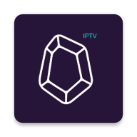
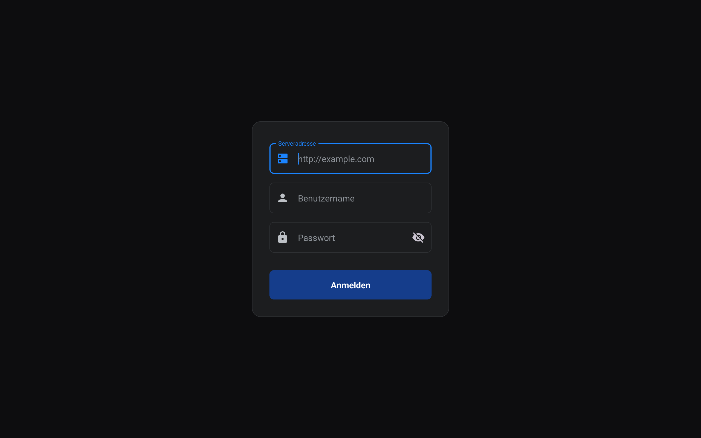

# flintrTV

Android-IPTV-App für Android-TV und Tablets — Xtream-Codes-API, Live-TV, Filme, Serien. Native Android-App in Kotlin/Compose mit modernem TV-optimiertem Design (dunkle Schwarztöne + Azurblau).

<p align="center">
  
</p>

## Features

- **Live-TV** mit Kanalwechsel per D-Pad (Up/Down), Zap-Timer und Kanal-Overlay
- **Filme & Serien** aus der Xtream-Mediathek, inkl. Staffel-/Episoden-Navigation
- **Player** auf Media3/ExoPlayer-Basis: 10s-Skips per D-Pad, Skip-Feedback auf der Zeitleiste, Auto-Commit nach dem Loslassen
- **Merken & Weitersehen**: Favoriten, Wiedergabeposition wird pro Content gespeichert, "Nächste Episode"-Autoplay
- **Suche** über alle Inhalte (Enter-Search ab 2 Zeichen — optimiert für TV-Fernbedienungen)
- **Debug-Varianten**: flintrTV und flintrTV Debug koexistieren auf demselben Gerät
- **Selbst-Update**: App prüft GitHub-Releases, lädt APK herunter und installiert es

## Screenshots

| Login | App-Start |
|---|---|
|  | *[weitere folgen]* |

## Installation

### Voraussetzungen
- Android 7.0+ (API 24), empfohlen: Android TV / Amazon Fire TV / Tablet
- Xtream-Codes-Zugang (Server-URL, Benutzername, Passwort)

### APK beziehen
Aktuelle Version über die [Releases](https://github.com/kabelklaus/flintriptv/releases) — direkt auf dem Gerät öffnen oder per `adb install` verteilen.

```bash
adb connect <gerät-ip>:5555
adb install flintrtv.apk
```

### Ersteinrichtung
1. App starten
2. **Serveradresse** eintragen (Xtream-Server, `http://…`)
3. **Benutzername** und **Passwort** des Xtream-Zugangs eingeben
4. **Anmelden** — Katalog lädt, fertig

## Bedienung (Fernbedienung / D-Pad)

| Taste | Aktion im Player |
|---|---|
| **Enter/OK** (1. Druck) | Overlay einblenden, Play/Pause ist fokussiert |
| **Enter/OK** (2. Druck) | Play/Pause umschalten |
| **Links/Rechts** | ±10s springen (Halten = Schritte ketten sich, Commit nach kurzem Loslassen) |
| **Hoch** | Nächster Kanal (Live-TV) |
| **Runter** | Voriger Kanal (Live-TV) |
| **Zurück** | Player verlassen / Overlay ausblenden |

## Tech-Stack

- **Sprache/UI**: Kotlin 2.0, Jetpack Compose (Material3), TV-Fokus-Ring-Design
- **Player**: Media3/ExoPlayer 1.3.1
- **Netzwerk**: Retrofit + Moshi
- **DI**: Hilt
- **Backend**: Firebase (Firestore-Sync, Crashlytics, Analytics, Performance)
- **Build**: Gradle 9.5, AGP 9, minSdk 24, target/compileSdk 36

## Bauen

```bash
export JAVA_HOME="/Applications/Android Studio.app/Contents/jbr/Contents/Home"
sh gradlew :app:assembleDebug      # Debug-APK
sh gradlew :app:testDebugUnitTest  # Unit-Tests
```

Release-Builds laufen über GitHub Actions auf `main` (`build-release.yml`) — lokal kein Keystore nötig.

## Projekt-Struktur

```
app/src/main/java/com/flintr/tv/
  data/         API (Xtream, GitHub), Cache, Credentials, Firestore-Sync
  model/        LiveStream, VodStream, Series, Category, WatchProgress
  repository/   Xtream-, User-, Update-Repository
  ui/
    navigation/ App-Navigation
    screens/    PlayerScreen, SeriesEpisodesScreen, LoginScreen
    components/ ContentCard, SearchOverlay, player/ (Controls, ProgressBar)
    theme/      Design-System (Azurblau auf Schwarz)
  viewmodel/    MainViewModel, PlayerViewModel, UpdateViewModel, …
```

## Status

- Aktuelle Version: **2.45 (103)**
- ~111 Kotlin-Dateien, 65 Test-Dateien
- Bekannte Security-Findings & Roadmap: siehe `konzept.md`

---

*Private App — Zugriff auf den Xtream-Server erforderlich.*
